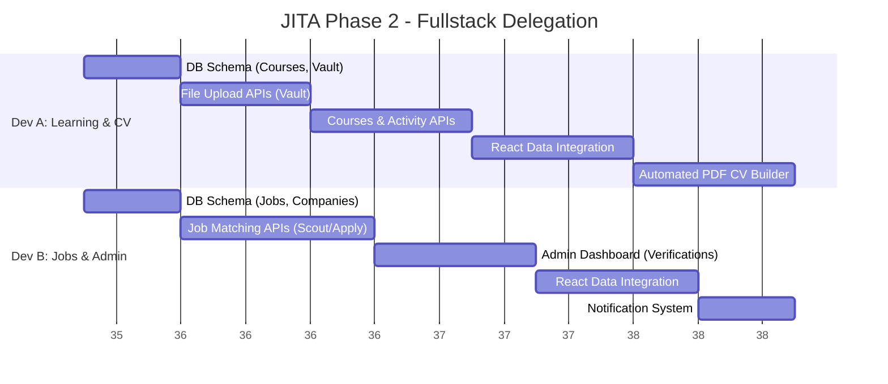
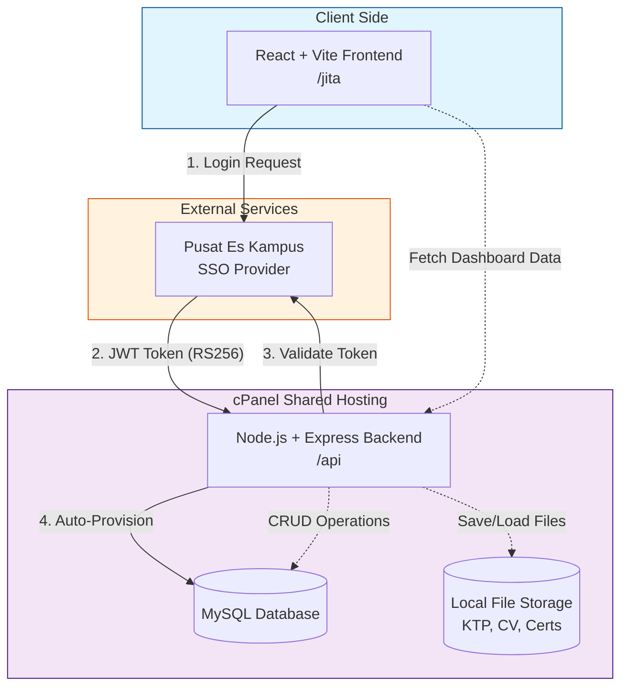
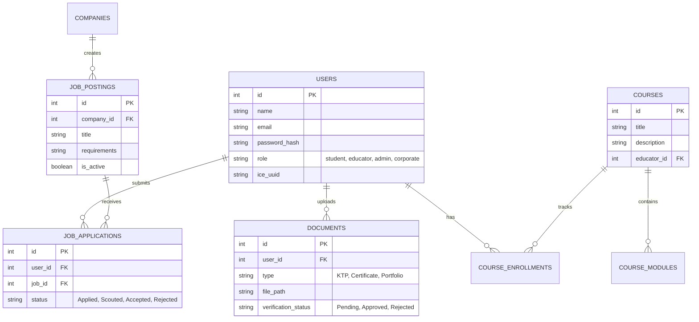

# JITA Project - Phase 2 Delegation Plan

This document provides the technical diagrams and work breakdown structure needed to onboard two full-stack developers to complete Phase 2 of the JITA project.

## 1. Work Breakdown Structure (Vertical Delegation)

To prevent the two developers from blocking each other, the work is divided into **Feature Verticals**. This means each developer will handle both the frontend integration and backend APIs for their specific features.

### 👨‍💻 Developer A (Learning & Profile Track)
**Focus:** Building the core user profile, file storage, and the learning ecosystem.
1.  **Document Vault:** Implement `multer` for file uploads (KTP, Certificates) to the server.
2.  **Learning Ecosystem:** Build the backend CRUD and frontend integration for Courses, Modules, and User Track Records.
3.  **CV Engine (Critical):** Implement the logic for `/api/cv/generate` using `puppeteer` or `pdfkit` to automatically generate the Japanese-standard PDF CV based on the user's profile and track record.

### 👩‍💻 Developer B (Job Matching & Admin Track)
**Focus:** Building the marketplace aspect and operational controls.
1.  **Job Marketplace:** Build the backend CRUD and frontend integration for Companies and Job Postings.
2.  **Two-Way Matching:** Implement the logic for Candidates to "Apply" and Companies to "Scout".
3.  **Admin Panel:** Build the data verification dashboard for admins to approve KTPs and certificates.
4.  **Notifications:** Implement the API gateway/email logic for system alerts (e.g., "You have been scouted!").

---

## 2. System Architecture (Current vs Future)

This diagram shows how the frontend, backend, and external services interact.

---

## 3. Recommended Database Schema (ERD)

This is a conceptual blueprint for the MySQL tables that need to be created. Currently, only the `users` table exists.

## 4. Key Directives for the Developers
*   **Database connection:** Remember that the MySQL connection in `server.js` is intentionally hardcoded as a config object (not a URL string) to bypass cPanel character parsing issues.
*   **Routing:** The Express app handles routing assuming it receives paths like `/sso/login` (cPanel Passenger strips the `/api` prefix internally). Ensure all new routes match this behavior as documented in `server.js`.
*   **Memory Limits:** Be mindful of CloudLinux LVE memory limits on the shared hosting. When implementing the PDF generation (CV Builder), prefer lightweight libraries if possible, or ensure heavy background processes don't crash the Node.js app.
