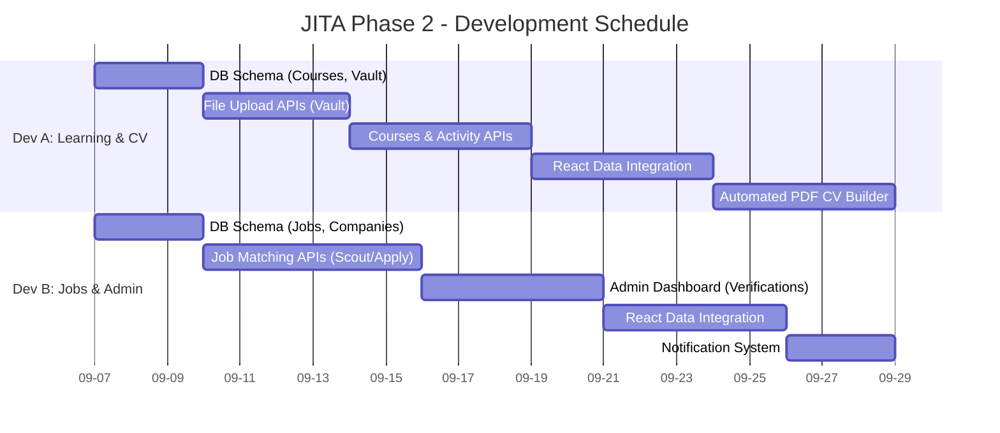

# JITA - Project Timeline & Schedule

This document outlines the development schedule for Phase 2, delegating tasks across two full-stack developers. 

**Project Start Date:** September 7, 2026
**Estimated Completion:** September 28, 2026 (approx. 3 weeks)

## 1. Interactive Gantt Chart

---

## 2. Detailed Task Schedule

*(Note: Durations are estimated in calendar days. Adjustments may be needed for weekends depending on your team's working schedule).*

### 👨‍💻 Developer A (Learning & Profile Track)
| Task | Start Date | End Date | Duration | Description |
| :--- | :--- | :--- | :--- | :--- |
| **1. DB Schema (Courses, Vault)** | Sep 7, 2026 | Sep 9, 2026 | 3 Days | Design and create MySQL tables for courses, modules, user enrollments, and document vault. |
| **2. File Upload APIs (Vault)** | Sep 10, 2026 | Sep 13, 2026 | 4 Days | Implement `multer` for secure file uploads (KTP, Certificates) to the local server. |
| **3. Courses & Activity APIs** | Sep 14, 2026 | Sep 18, 2026 | 5 Days | Build RESTful CRUD APIs for the learning ecosystem and track records. |
| **4. React Data Integration** | Sep 19, 2026 | Sep 23, 2026 | 5 Days | Connect the frontend Student/Educator dashboards to the new APIs, replacing mock data. |
| **5. Automated PDF CV Builder** | Sep 24, 2026 | Sep 28, 2026 | 5 Days | Implement the `/api/cv/generate` logic using a PDF library to auto-generate Japanese-standard CVs. |

### 👩‍💻 Developer B (Job Matching & Admin Track)
| Task | Start Date | End Date | Duration | Description |
| :--- | :--- | :--- | :--- | :--- |
| **1. DB Schema (Jobs, Companies)** | Sep 7, 2026 | Sep 9, 2026 | 3 Days | Design and create MySQL tables for companies, job postings, and applications. |
| **2. Job Matching APIs** | Sep 10, 2026 | Sep 15, 2026 | 6 Days | Build backend logic for Two-Way Matching (Candidates applying and Companies scouting). |
| **3. Admin Dashboard** | Sep 16, 2026 | Sep 20, 2026 | 5 Days | Build the APIs and UI components for the data verification dashboard (approving KTPs/certs). |
| **4. React Data Integration** | Sep 21, 2026 | Sep 25, 2026 | 5 Days | Connect the frontend Corporate and Admin dashboards to the new APIs, replacing mock data. |
| **5. Notification System** | Sep 26, 2026 | Sep 28, 2026 | 3 Days | Implement API gateway/email logic for system alerts (e.g., scout notifications). |

## 3. Milestones & Check-ins
*   **Checkpoint 1 (Sep 9):** Database schemas for both verticals should be finalized and migrated.
*   **Checkpoint 2 (Sep 18):** Core backend APIs for both verticals should be functional and tested via Postman/Insomnia.
*   **Checkpoint 3 (Sep 25):** Frontend should be successfully consuming real data.
*   **Final Delivery (Sep 28):** CV Builder and Notification systems are online. Ready for UAT (User Acceptance Testing).

---

## 4. Payment Terms (Termin Pembayaran)
To align with the development milestones, the payment is divided into three terms:

*   **Termin 1 (20% - Down Payment):** Processed at the start of the project (Sep 7).
*   **Termin 2 (50% - Progress Payment):** Processed upon the completion of Checkpoint 2 (Sep 18), when all core backend APIs are functional.
*   **Termin 3 (30% - Final Settlement):** Processed upon Final Delivery and successful User Acceptance Testing (Sep 28).
